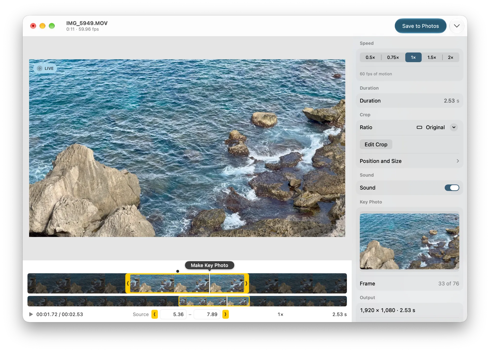

<p align="center">
  
</p>

<h1 align="center">Still</h1>

<p align="center">
  <strong>Turn any moment of a video into a real Live Photo.</strong><br>
  Trim, retime, and crop a few seconds of video on your Mac, then save a Live Photo that Photos plays like one shot on iPhone.
</p>

<p align="center">
  
  
  
  <a href="LICENSE"></a>
</p>

<p align="center">
  
</p>

## Features

- **Genuine Live Photos.** Still writes the same paired JPEG and MOV the iPhone camera does, with a shared content identifier and a still-image marker, so Photos treats the result as a real Live Photo. It isn't a GIF or a plain video.
- **Make Key Photo, like on iPhone.** Scrub to any frame and click the bubble. If the frame is outside the selection, the selection comes to it.
- **Trim with brackets.** Yellow brackets trim directly. A two-level timeline lets you place a 3-second clip precisely in a 10-minute video.
- **Speed without chipmunks.** Play at 0.5×–2× with pitch-preserved, frame-accurate sound. Speed keeps the moment you picked, and Still shows the motion frame rate and estimated file size before you export.
- **Choose size and quality.** Export at 4K, 1080p or 720p, at a Low to Very High bit rate. Still shows the bit rate and the file size before you save.
- **Crop to any shape.** Choose a preset (1:1, 4:5, 9:16, …), a custom ratio, or freeform, and reposition with direct handles or exact pixel values.
- **What you see is what you save.** The preview, the Key Photo, and the export all render through one composition. The LIVE badge plays the actual result in the system Live Photo player.
- **HDR kept.** iPhone HDR video (HLG, Dolby Vision, HDR10) stays HDR: a 10-bit HLG video and a Key Photo with an HDR gain map, like iPhone HDR photos. Turn HDR off for standard color that looks the same on every screen.
- **Mac-native.** It's built with SwiftUI, with:
  - one window per video, full undo and redo, and keyboard shortcuts for every edit;
  - drag and drop from Finder or Photos;
  - light and dark mode, and Liquid Glass on macOS 26.
- **Keeps when and where it was taken.** The Live Photo takes the video's date, at the Key Photo's moment, and its camera, so it sorts with that day's photos. Include the video's location, or choose one on a map, and Photos shows it under Places.
- **Private by design.** Photos access is add-only and requested only when you save. Your videos are processed on your Mac. Apple Maps is used only to show or find a location you include.

## Download

Download the latest DMG from [Releases](https://github.com/FacundoChan/Still/releases), open it, and drag **Still** to Applications.

## Using Still

1. **Open a video.** Drop it on the window, or choose **Open Video…** (⌘O) or **Choose from Photos…** (⇧⌘O).
2. **Find the moment.** Scrub the timeline, then click **Make Key Photo**.
3. **Shape it.** Drag the yellow brackets, pick a speed, or crop. Hover over **LIVE** to preview the real Live Photo.
4. **Save.** Click **Save to Photos** (⌘S) or **Export Files…** (⇧⌘E) for a matched JPEG and MOV.

### Keyboard shortcuts

| Key | Action |
|---|---|
| Space | Play or pause: the selection as it will export, or the source at 1× outside it |
| K or Return | Make Key Photo at the playhead |
| I / O | Trim the start / end to the playhead |
| ← / → (⇧ for 10) | Step one frame; in Crop mode, nudge the crop |
| C | Crop mode |
| L | Preview the Live Photo |
| ⌘S / ⇧⌘E | Save to Photos / Export Files… |
| ⌘. | Cancel an export |
| ⌘Z / ⇧⌘Z | Undo / Redo |

## How it works

A Live Photo is two files tied together by a shared UUID:

| | Key Photo | Paired video |
|---|---|---|
| Format | JPEG, sRGB; in HDR, Display P3 with an ISO gain map | HEVC MOV at a constant 30 fps, with AAC sound; in HDR, 10-bit HLG |
| Identifier | Apple MakerNote key 17 | `com.apple.quicktime.content.identifier` |
| Timing | — | A timed metadata track, `com.apple.quicktime.still-image-time`, on the Key Photo's frame |

Still builds one AVFoundation composition from your edit: trim, speed, orientation, crop, and color, either HLG or standard color. Preview playback, the Key Photo, and the export all read from it, so they match by construction.

A single AVAssetReader → AVAssetWriter pass encodes the movie and captures the Key Photo from the exact frame it encodes. Sound is retimed offline with `AVAudioUnitTimePitch`, which keeps it within 5 ms of the picture; AVFoundation's built-in time-pitch lags up to 92 ms at speed-ups. Finally `PHAssetCreationRequest` saves the pair as one asset.

## Compatibility

- **Runs on** macOS 26 Tahoe or later, as a universal binary.
- **Tested on** macOS 27.0 on Apple silicon.
- **Opens** anything AVFoundation can decode, at any frame rate, including variable frame rate and 120 fps or more. That includes H.264, HEVC, ProRes, Dolby Vision, HLG, and HDR10, in MOV, MP4, and other movie containers.
- **Produces** Live Photos with HEVC video, which needs macOS 10.13 or iOS 11 or later to play. HDR Key Photos show as HDR in Photos on macOS 15 and iOS 18 or later, and as standard photos elsewhere.

## Building from source

You need macOS 26 or later, **Xcode 27.1** or later, and [XcodeGen](https://github.com/yonaskolb/XcodeGen) (`brew install xcodegen`).

```bash
git clone https://github.com/FacundoChan/Still.git
```

```bash
cd Still && xcodegen generate && open Still.xcodeproj
```

Choose the **Still** scheme and press ⌘R. To build under your own Apple ID, first set `DEVELOPMENT_TEAM` in [`project.yml`](project.yml) to your team ID. The Xcode project is generated from that file, so edit it rather than the project.

To install your build as `/Applications/Still.app`, run `Scripts/install.sh`.

## Project structure

| Path | Contents |
|---|---|
| [`StillCore/`](StillCore) | Framework: editing model, render pipeline, Live Photo export and inspection, Photos saving |
| [`Still/App`](Still/App) | App entry, window routing, close and quit confirmation, temporary files |
| [`Still/Editor`](Still/Editor) | Per-window model: editing, undo, playback, background renders, export stages and recovery |
| [`Still/Views`](Still/Views) | Stage, crop overlay, timeline, inspector, drop target |
| [`Still/AppIcon.icon`](Still/AppIcon.icon) | App icon, an Icon Composer file with SVG layers |
| [`StillCoreTests/`](StillCoreTests) | Tests |

## Roadmap

- Verify on macOS 26, on Intel, and with iPhone slow-motion (240 fps) footage
- A full VoiceOver audit
- Batch: several Live Photos from one video in a single pass

## Contributing

Issues and pull requests are welcome. Before a pull request:

- Run the tests: generate the test videos with `Scripts/make-fixtures.sh` (needs ffmpeg), then press ⌘U in Xcode.
- Keep the code in the style of its surroundings. The project uses Swift 6 strict concurrency, SwiftUI with AppKit where it helps, and no third-party dependencies in the app.
- Explain behavior changes, and why, in the pull request.

## Acknowledgments

- [LivePhoto](https://github.com/LimitPoint/LivePhoto) by LimitPoint, an early reference for the Live Photo file format.
- Apple's [PHAssetCreationRequest](https://developer.apple.com/documentation/photos/phassetcreationrequest) and AVFoundation documentation.

## License

Still is released under the [MIT License](LICENSE).
